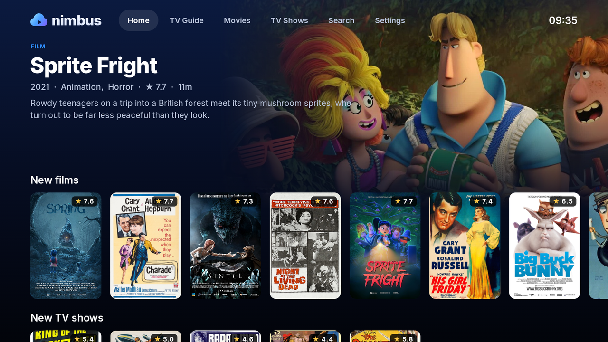
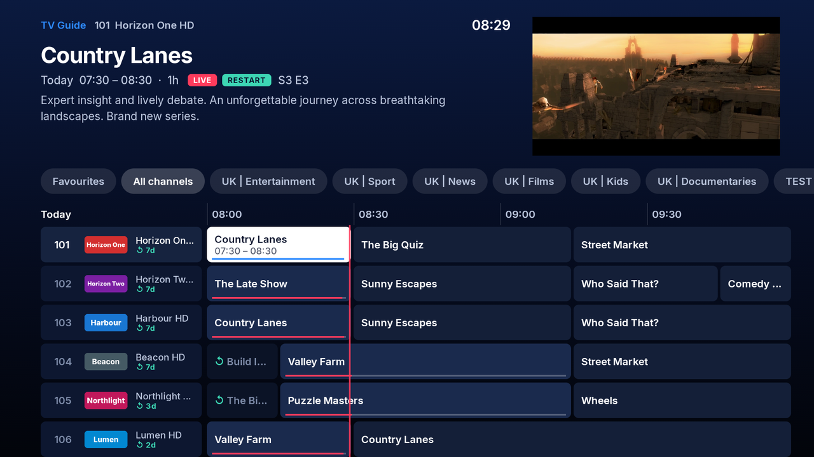
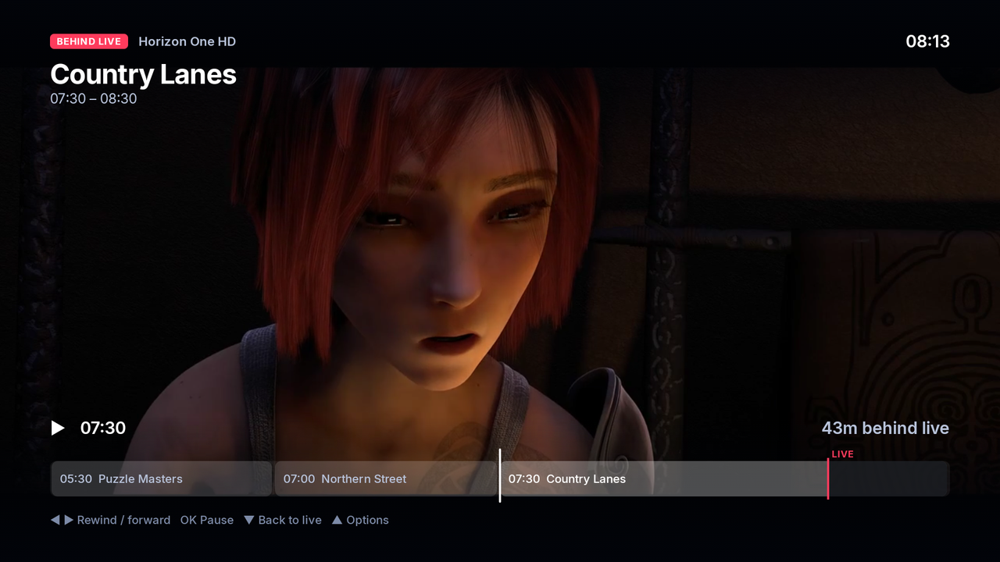
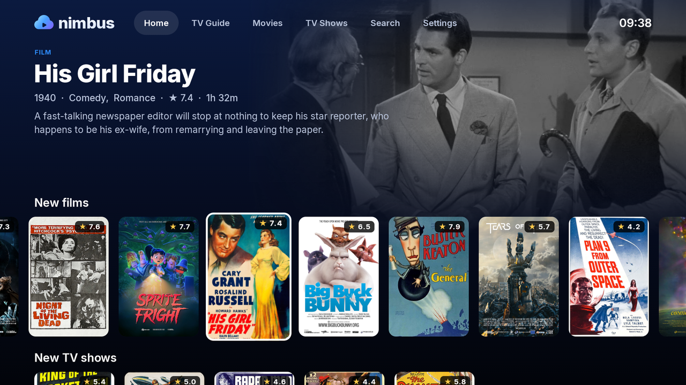
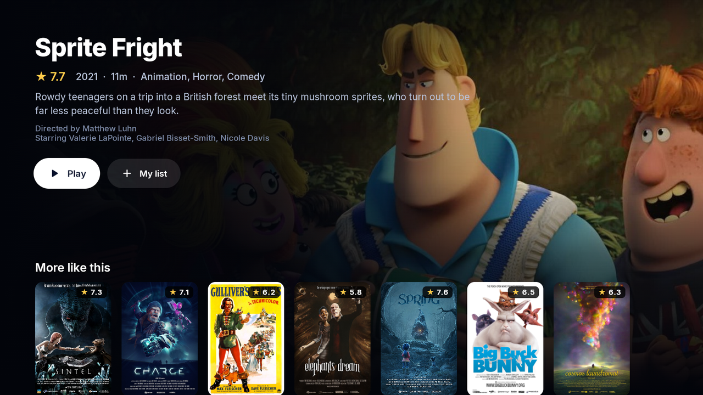
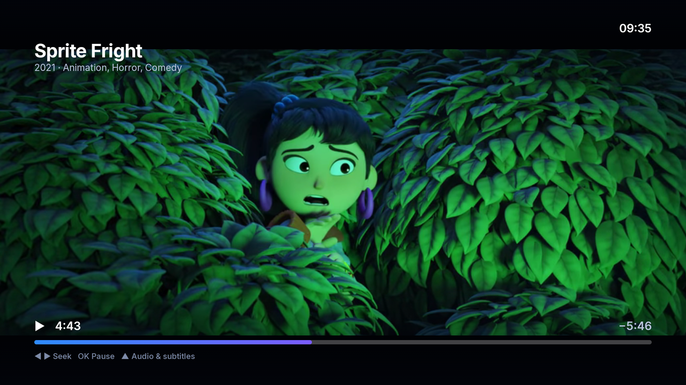
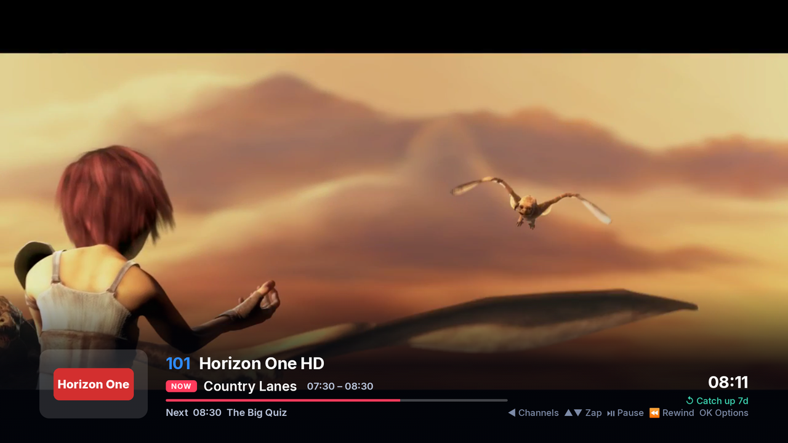

<p align="center">
  
</p>

<p align="center">
  <b>A fast, free and open-source IPTV player for Android TV and Fire TV.</b><br>
  Live TV with a proper programme guide, catch-up, and your films and series, in one smooth, remote-first app.
</p>

<p align="center">
  <a href="https://github.com/lucasclgibson/nimbus/releases/latest"></a>
  <a href="https://github.com/lucasclgibson/nimbus/actions/workflows/ci.yml"></a>
  <a href="LICENSE"></a>
  
</p>

<p align="center">
  
</p>

## Features

- **Live TV like a set-top box.** A programme guide you can scroll days back and forward, channel groups,
  favourites, reminders, live sport at a glance, and a mini TV that keeps playing while you browse.
- **Pause and rewind live TV.** Every channel records into a memory buffer while you watch: pauses resume
  exactly where you left off, and short network drops never reach the screen.
- **Catch-up as one continuous timeline.** Play any past programme or watch a live one from the start, then
  scrub straight across programmes through the channel's whole archive, all the way back to live.
- **Films and series.** Categories, posters, seasons and episodes, resume points, Continue watching and
  My list. Add a free [TMDB](https://www.themoviedb.org/) API key for ratings, reviews, cast and trailers.
- **Search that keeps up.** Channels, what's on, films and series, answering every key press, with an
  on-screen keyboard that sits beside the results instead of covering them.
- **Smooth playback first.** Media3 (ExoPlayer) with an FFmpeg audio fallback, frame-rate matching
  (50 Hz for European TV, 23.976 Hz for films) switched before playback starts, seeking that always lands on
  a complete picture, and reconnects hidden behind the buffer.
- **Simple setup.** Xtream Codes logins or M3U playlists with XMLTV guides and catch-up templates. Type long
  addresses and passwords on your phone by scanning a QR code instead of using the remote.
- **For the whole household.** Parental PIN, adult group locking and hidden channel groups, plus an optional
  hub on your home network that syncs playlists, favourites and resume points between TVs.

> [!NOTE]
> Nimbus is a player. It doesn't include or provide any channels, playlists or content: use it with
> playlists you're entitled to use.

## Screenshots

| | |
| --- | --- |
|  |  |
| **TV guide**: days back and forward, catch-up marked | **Catch-up**: scrub straight across programmes |
|  |  |
| **Films and series**: new arrivals, ratings and plots at a glance | **Details**: cast, plot and more like this |
|  |  |
| **Films**: seek with the remote, pick up where you left off | **Live TV**: now and next, pause and rewind |

## Install

1. Download `Nimbus-x.y.z.apk` from the [latest release](https://github.com/lucasclgibson/nimbus/releases/latest).
2. Install it on your TV:
   - **Fire TV:** turn on *Settings → My Fire TV → Developer options → Install unknown apps* for the
     Downloader app (free in the Amazon Appstore), then open the APK's address in Downloader.
   - **Android TV / Google TV:** use a file manager or Downloader the same way, or
   - **Any TV with ADB debugging on:** `adb connect <tv-address>:5555 && adb install Nimbus-x.y.z.apk`.
3. Open Nimbus and add your playlist, on the TV or from your phone (*Settings → Add from phone* shows a QR code).

Nimbus runs on Android TV, Google TV and Fire TV devices with Android 7.1 or later, and is built for remote
control navigation on 1080p and 4K TVs. Updates are new releases: install them over the top, your setup stays.

## Using Nimbus

| Where | Keys |
| --- | --- |
| TV guide | ◀ ▶ programmes, past and future · ▲ ▼ channels · ⏪ ⏩ a day back or forward · ⏯ back to now · OK watch (catch-up if it's past) · ☰ options, favourites and channel groups |
| Live TV | ▲ ▼ change channel · ◀ channel list · OK banner · OK again or ☰ for options · ⏪ ⏩ rewind and forward · ⏯ pause |
| Catch-up | ◀ ▶ rewind and forward across programmes (hold to go faster) · OK pause · ▼ back to live · ▲ or ☰ options |
| Films and episodes | ◀ ▶ seek (hold to go faster) · OK pause · ▲ or ☰ audio, subtitles and picture |
| Rows and grids | ☰ on a title for its options: My list, or remove from Continue watching |
| Search | the on-screen keyboard beside the results · ⏪ delete · ⏩ space · select the search box for the system keyboard |

On remotes without a ☰ button, hold OK instead.

## Building from source

You need JDK 21 and the Android SDK (API 35). Then:

```bash
./gradlew assembleDebug           # app/build/outputs/apk/debug, installs alongside a release build
./gradlew testReleaseUnitTest     # unit tests (MPEG-TS parsing, recording and splicing, frame rates, guide)
```

Release builds are minified and need a signing key. CI passes it in environment variables
(`NIMBUS_KEYSTORE`, `NIMBUS_KEYSTORE_PASSWORD`, `NIMBUS_KEY_ALIAS`, `NIMBUS_KEY_PASSWORD`); locally you can
point `NIMBUS_SIGNING_PROPERTIES` at a properties file with `storeFile`, `storePassword`, `keyAlias` and
`keyPassword`. Without a key, `assembleRelease` produces an unsigned APK.

<details>
<summary>Building on an ARM64 Linux machine</summary>

Google only publishes the `aapt2` build tool for x86_64 Linux. Install an ARM64 build of the SDK build tools
and point Gradle at it in your own `~/.gradle/gradle.properties`:

```properties
android.aapt2FromMavenOverride=/path/to/build-tools/35.0.0/aapt2
```
</details>

### Tools for working on a TV

Copy `tools/local.env.example` to `tools/local.env` and set your TV's ADB address. Then:

| Tool | What it does |
| --- | --- |
| `tools/deploy.sh [--launch]` | builds a release, installs it and compiles it ahead of time, so it's smooth from the first launch |
| `tools/tv.sh` | drives the TV over ADB: `key UP OK`, `text hello`, `shot name` (screenshot), `log`, `launch` |
| `tools/mock-xtream/server.py` | a fake Xtream Codes panel (login `demo` / `demo`) for testing without a provider |
| `tools/hub/nimbus_hub.py` | the optional household hub: sync between TVs and update delivery (`tools/publish.sh`) |
| `tools/make_brand.py` | draws the logo, icons, TV banner, launch screen and these docs' artwork |

The mock panel serves live MPEG-TS channels generated with ffmpeg (playing the Sintel trailer if
`make_media.sh` could download it, test patterns otherwise), a week of guide data, catch-up archives stored the
way real panels store them, a large synthetic film and series library, and channels that misbehave on purpose
(dropping, freezing, refusing, changing timestamps), which is how the reliability features are tested. It also
has real films and serials: open movies and public-domain classics, listed in `library.json`, whose posters and
stills `make_media.sh` downloads from Wikimedia Commons and which play their copies there. With `--showcase` it
serves only those, without the test channels (the screenshots above are taken that way). It needs Python 3 with Pillow, and ffmpeg. Generate its media once with `tools/mock-xtream/make_media.sh`, then run
`python3 tools/mock-xtream/server.py` and add `http://<this-machine>:8899` as an Xtream Codes playlist.

### How it fits together

```
app/src/main/java/io/github/lucasclgibson/nimbus/
  core/         formatting, HTTP client, background work
  data/db/      Room database: playlists, channels, guide, films, series, favourites, history
  data/source/  Xtream Codes API, M3U and XMLTV parsers, catch-up URLs, TMDB
  data/repo/    imports and repositories; the search index
  data/hub/     household sync and updates
  player/       one ExoPlayer for the whole app, the live/catch-up recorder (LiveBuffer),
                MPEG-TS parsing (Ts), frame-rate detection and matching
  phone/        the setup page your phone opens from the QR code
  ui/           Compose for TV screens: home, guide, browse, details, player, search, settings
```

## Releases

Nimbus follows [semantic versioning](https://semver.org/). The version lives in one place, `nimbus.version`
in `gradle.properties`, and every change worth knowing about goes under *Unreleased* in
[CHANGELOG.md](CHANGELOG.md). To release, run `tools/release.sh 1.2.0` on `main`: it sets the version, dates
the changelog, commits, tags `v1.2.0` and pushes. The [Release workflow](.github/workflows/release.yml) then
tests, builds and signs the APK and publishes it with its checksum and that version's changelog as the notes.

## Contributing

Bug reports, ideas and pull requests are welcome. Please run the unit tests, and say which TV you tested on:
playback behaviour varies a lot between devices and providers.

## License

Nimbus is free software under the [GNU General Public License v3.0](LICENSE).

It's built on [Media3](https://github.com/androidx/media), [Jetpack Compose for TV](https://developer.android.com/jetpack/compose/tv),
[Room](https://developer.android.com/training/data-storage/room), [OkHttp](https://square.github.io/okhttp/),
[Coil](https://coil-kt.github.io/coil/) and [ZXing](https://github.com/zxing/zxing) (Apache 2.0), the
[Jellyfin FFmpeg decoder](https://github.com/jellyfin/jellyfin-androidx-media) (GPL-3.0) and the
[Inter](https://rsms.me/inter/) typeface (SIL Open Font License, see [tools/INTER-LICENSE.txt](tools/INTER-LICENSE.txt)).
Film and TV details come from [TMDB](https://www.themoviedb.org/): this product uses the TMDB API but is not
endorsed or certified by TMDB.

The screenshots show the built-in test panel. Its channels and programmes are made up; its films and serials
are real, and free to show: open movies under Creative Commons licences (most from the Blender Foundation) and
classics in the public domain, with their posters and stills from Wikimedia Commons. Every image is credited in
[docs/screenshots/CREDITS.md](docs/screenshots/CREDITS.md).
